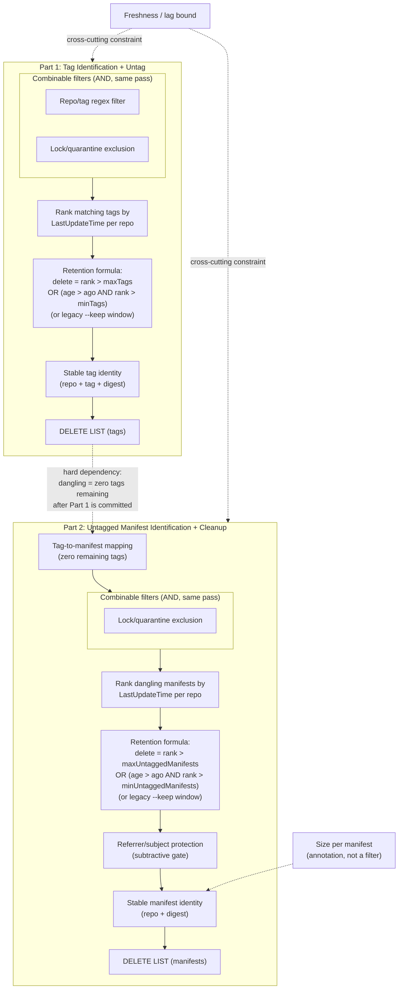

# Azure Resource Graph (ARG) Integration for Purge: Requirements Spec

## Summary

Draft / discussion notes. This doc assumes that ARG is enabled for an azure container registry and that said ARG is capable of providing manifest and tag level information. The goal here is to document what types of queries we currently support today in the acr-purge command by building a registry store locally. If we want to provide ARG support we need to provide similar functionality though we can build a separate more constrained purger if necessary. There are no concrete queries here, just scenarios and expectations supported by the existing purger.

## Background

Today, `acr purge` derives delete decisions by enumerating a registry's
catalog, tags, and manifests directly via data-plane calls
(see `cmd/acr/purge.go`). Purge runs in two phases:

1. **Tag identification + untag** (`purgeTags`)
2. **Untagged manifest identification + cleanup** (`purgeDanglingManifests`)

The goal of ARG integration is to let ARG compute the delete set(s), with
purge (or a thin executor) only issuing the data-plane delete calls against
that set.

This spec also folds in the retention-policy proposal from
[Azure/acr-cli#670](https://github.com/Azure/acr-cli/issues/670), which adds
`--min-tags`/`--max-tags` and `--min-untagged-manifests`/`--max-untagged-manifests`.
That proposal replaces simple "keep-N" with a per-repo rank plus a combined
OR/AND formula which will be merged soon and has been asked for by openai.

```text
delete := rank > maxCount
          OR
          (olderThanAgo AND rank > minCount)
```

`--min-*` requires `--ago` (it only guards age-based deletion); `--max-*` is a
hard ceiling independent of age; `--keep` remains unchanged but is mutually
exclusive with the new min/max options for the same resource. This means any
ARG query plan must compute **rank** before applying age, not after.

## Requirements Graph



As visible from the diagram above we have a hard dependency between the two flows. I am not sure ARG can support such real time updates so we might still need a small clientside wrapper. Also note that we avoid executing deletions based on locks, if ARG does not have this information its not a must. We can issue deletes which will get rejected instead of avoiding the requests and do not need to support locked image cleanup.

## Part 1: Tag Identification + Untag

| # | Requirement | Order/Dependency | Open Question |
|---|---|---|---|
| 1a | Repo/tag regex filter | Defines the "matching" set, applied first, combinable with 4a | Server-side pattern match, or pulled then filtered client-side? |
| 2a | Age threshold (tag last-updated) | Combined via formula with 3a/5a, not pre-filtered | Last update time (push) today (Last pull might be nice later) |
| 3a | Rank matching tags by recency, per repo | Must run before the retention formula; needed for `--keep`, `--min-tags`, and `--max-tags` alike | Native ranking/windowing, or client-side post-processing? |
| 4a | Lock/quarantine exclusion | Same pass as 1a; locked items also need to be reportable when they block a `--max-tags` ceiling | Single boolean, or distinguish quarantine vs. explicit lock? If not present, this can be skipped |
| 5a | Retention formula (min/max/keep) | `delete = rank > maxTags OR (age > ago AND rank > minTags)`; legacy `--keep` is a separate, mutually exclusive mode | Can the index evaluate this formula natively, or must it be computed client-side after fetching rank+age? |
| 6a | Freshness/lag bound | Cross-cutting on whole pipeline | Indexing SLA, per-registry or global? |
| 7a | Stable tag identity (repo + tag + digest) | Final output shape | Sufficient to call untag directly, or needs re-resolution? |
| 8a | Delete-reason attribution (age vs. max vs. both) | Annotation on final output, required for dry-run parity with #670 | Can the query surface *why* each row was selected, or only the final boolean? |

## Part 2: Untagged Manifest Identification + Cleanup

| # | Requirement | Order/Dependency | Open Question |
|---|---|---|---|
| 1b | Tag-to-manifest mapping (zero remaining tags) | Must run after Part 1's deletions are reflected | Does the index reflect tag deletions in near-real-time, or only on next sync? |
| 2b | Lock/quarantine exclusion | Defines the "matching" dangling set, same pass as 1b | Does lock state apply at manifest level independent of tag locks? |
| 3b | Age threshold (manifest last-updated) | Combined via formula with 4b/5b, not pre-filtered | Does manifest "last-updated" change on retag, or only on push? |
| 4b | Rank dangling manifests by recency, per repo | Must run before the retention formula; needed for `--keep`, `--min-untagged-manifests`, and `--max-untagged-manifests` alike | Same ranking capability as 3a, but scoped to manifests |
| 5b | Retention formula (min/max/keep) | `delete = rank > maxUntaggedManifests OR (age > ago AND rank > minUntaggedManifests)`; evaluated after tag deletion per #670 | Same as 5a, scoped to manifests |
| 6b | Referrer/subject protection | Subtractive gate before finalizing output | Does the index expose referrer edges (signatures/SBOMs), and in which direction? |
| 7b | Size per manifest | Additive annotation, not a filter | Tracked per manifest, per layer, or both? |
| 8b | Freshness/lag bound | Cross-cutting on whole pipeline | Same as 6a |
| 9b | Stable manifest identity (repo + digest) | Final output shape | Sufficient to call manifest delete directly? |
| 10b | Delete-reason attribution (age vs. max vs. both) | Annotation on final output, required for dry-run parity with #670 | Same as 8a, scoped to manifests |

## Validation Rules Carried Over from #670

- `--keep` behavior is unchanged and mutually exclusive with `--min-*`/`--max-*`
  for the same resource (tags vs. dangling manifests are independent).
- `--min-tags`/`--min-untagged-manifests` require `--ago`; they only guard
  age-based deletion and cannot select items on their own.
- `--max-tags`/`--max-untagged-manifests` work with or without `--ago`.
- When both are supplied, `min <= max`.
- Limits apply per repository and effective filter; tag and dangling-manifest
  limits are independent of each other.
- Ranking must be deterministic and stable across paginated results, with a
  defined tie-break for equal `LastUpdateTime` values.
- Dry-run output must distinguish whether a deletion is due to age, a max-count
  ceiling, or both, so any ARG-backed plan needs to preserve that attribution,
  not just emit a final delete/keep boolean.

## Cross-Phase Dependency

Part 2's entry point (tag-to-manifest mapping) has a hard dependency on
Part 1's delete list being executed or at least finalized: "dangling" is only
meaningful relative to the post-Part-1 tag state, not the pre-purge snapshot.
This is the only edge connecting the two phases.

## Read-Only Prototype: Basic Untagged Cleanup

`scripts/experimental/arg-purge` is a standalone Go prototype that explores
Part 2 without changing `acr purge`. It never untags, deletes, pushes, changes
roles, or uses IMDS.
It uses the current Azure CLI identity through `az rest`, with independently
selectable regional ARM endpoint and API version. No `resource-graph`
extension is required.

The basic predicate is **older than X days AND untagged AND not reachable from
a tagged manifest**, not an OR between untagged and unreferenced. An untagged
platform manifest underneath a tagged multi-architecture index must survive.
The existing purger uses manifest `lastUpdateTime`; ARG's observed field is
`pushedAt`. The prototype explicitly reports that different age basis.

### Live Findings (October 14, 2026)

For `esreyacrcli.azurecr.io`, subscription
`e41344e4-fa06-4f72-b974-00bc6d058dc4`:

- Initial subscription-wide probes through Southeast Asia, West US, and the
  global endpoint succeeded but returned zero artifact rows. Later, the same
  Southeast Asia endpoint returned **479 rows: 429 manifests and 50 tags**.
  No roles, registry settings, or content were changed by this prototype.
- The Southeast Asia endpoint returned the registry from the `Resources`
  table. Its ARM location is `westus`; the query endpoint need not match that
  location.
- The first captured ARG inventory covered only `test-1` through `test-5`,
  while the data-plane catalog contained **34 repositories**. Its `pushedAt`
  values were all around 21:50 UTC on October 14. A separate data-plane sample
  from `mostuntagged-1` contained untagged manifests last updated February 5.
  Full historical coverage is therefore not demonstrated.
- Using the consistent capture, `--ago-days 0` selected **101 candidates** and
  protected **328 manifests**. Candidate counts by repository were 17, 17, 31,
  25, and 11 for `test-1` through `test-5`. `--ago-days 7` selected zero.
- All 101 candidates existed and were untagged in subsequent data-plane
  metadata reads. For 81, ARG `pushedAt` and data-plane `lastUpdateTime` matched
  to the second; 20 differed, including ARG `21:50:37Z` versus data-plane
  `21:50:41.6259014Z`. These are not proven interchangeable timestamps.
- A tagged index in `test-4`, digest
  `sha256:24fe3f96130d0a339632f67bc62fc0794ec57d54b42ac681af53efa360600744`,
  had exactly the same four child digests in ARG and its data-plane manifest
  body. This checks one real reference edge set, not the entire graph.
- Subsequent data-plane counts for those five repositories totaled **2,545
  manifests**, versus 429 in the initial ARG capture. All 429 captured digests
  still existed. These were non-atomic observations during changing inventory,
  not a measurement of steady-state ingestion lag.
- Later live ARG queries showed duplicate repository/tag names with different
  digest targets, for example `test-1:tag3`. The prototype rejects this
  ambiguity rather than choosing a target and emitting a misleading plan.

**Conclusion:** the observed schema supports a read-only ARG-backed candidate
prototype. Registry-wide completeness, freshness, timestamp equivalence,
and full data-plane reference parity are **not established**. Do not delete
based on this experiment. The supplied onboarding and cluster-access document
titles were not links or local files; their contents were unavailable.

### Querying the API

Run live candidate selection (defaults: Southeast Asia, API `2024-04-01`):

```bash
go run ./scripts/experimental/arg-purge \
  --registry-id /subscriptions/e41344e4-fa06-4f72-b974-00bc6d058dc4/resourceGroups/esrey/providers/Microsoft.ContainerRegistry/registries/esreyacrcli \
  --ago-days 7
```

Add `--discover` to return raw records instead of candidates. Capture discovery
output using `> /path/to/artifacts.json`, then replay it with
`--snapshot /path/to/artifacts.json --ago-days 0`. The capture contains the
registry ID and must match the requested scope.

The Go command POSTs to
`https://southeastasia.management.azure.com/providers/Microsoft.ResourceGraph/resources?api-version=2024-04-01`
with the ARM token audience `https://management.azure.com/` and this query:

```kusto
ContainerRegistryResources
| where type =~ 'microsoft.containerregistry/registries/artifacts'
| where id startswith '/subscriptions/e41344e4-fa06-4f72-b974-00bc6d058dc4/resourceGroups/esrey/providers/Microsoft.ContainerRegistry/registries/esreyacrcli/'
| order by id asc
```

It requests `objectArray` results, follows `$skipToken`, and rejects truncation
without continuation, repeated tokens, or changing record counts. An empty
inventory is an explicit error, not an empty candidate list. Ordering and
count checks do not make multiple ARG pages a transactionally consistent
snapshot. Native artifact IDs observed here are hierarchical beneath the
registry, so scoping does not depend on the opaque `registryArtifact.registryId`.
Use `--endpoint-region global` for a global comparison with the same API
version. The supplied example's `%22` at the end of the URL is a pasted quote,
not part of the API version.

### Native Mapping and Selection

The observed native mapping is:

| Native Field | Meaning |
|---|---|
| `kind` | `Manifest` or `Tag` |
| `properties.registryArtifact.repository` | Repository name |
| `properties.registryArtifact.digest` | Manifest digest / tag target |
| `properties.registryArtifact.tag` | Tag name on a `Tag` row |
| `properties.registryArtifact.pushedAt` | Observed push timestamp; not validated as data-plane `lastUpdateTime` |
| `properties.registryArtifact.manifest` | Indexed manifest body |
| `...manifest.manifests[].digest` | Child manifest edges on indexes/lists |
| `...manifest.subject.digest` | Subject edge, when present in an OCI body |

There is no tag array on the manifest row: the command combines **all** tag
rows with manifest rows using repository + digest. The top-level resource
`tags` property is not the image's tags. Children come from manifest
descriptors, not config/layer digests. Recognized image manifests without a
subject have no subject edge according to their manifest schema; unknown
media types and incomplete manifest bodies are rejected. Live subjects were
not present in this capture, so subject handling is covered by fixtures only.

Fetch **all** manifests and tags, not just old or untagged rows.
The selector builds a repository-scoped digest graph, traverses all descendants
of retained roots, then selects old untagged manifests outside that graph.
It protects shared and nested children, handles cycles, and keeps repositories
separate even when digests coincide. Roots include tagged manifests and
manifests at or newer than the cutoff. Conservatively, referrers and their
subjects also remain protected, along with their descendants. This is more
constrained than the existing purger's server-managed subject cleanup and is
not intended as behavioral parity.

Missing fields, invalid timestamps, duplicate manifest identities, ambiguous
tag names, cross-registry rows, and absent referenced manifests are errors.
Validation cannot detect wholly absent/disconnected artifacts or missing tag
rows due to indexing lag. Locks are not evaluated, so candidates are not
necessarily deletable.
Output contains the cutoff, inventory/protection/candidate counts, and
repository + digest + `ageTimestamp` + reason for each candidate. `ageBasis`
explicitly distinguishes ARG `pushedAt` from a synthetic timestamp.

Offline algorithm fixtures may also use `--snapshot` with a normalized JSON
array. Required fields are `id`, `repository`, `digest`, `tags` (array),
`ageTimestamp` (RFC3339 timestamp), `children` (digest array), and `subject`
(digest string or explicit null). This normalized format is not the native
ARG schema.

### Feasibility and Remaining Gates

The native fields support a KQL age predicate:

```kusto
| where kind == 'Manifest'
| where todatetime(properties.registryArtifact.pushedAt) < ago(7d)
```

A live server-side age-count query succeeded and returned zero old manifests.
Tag rows can be joined by repository + digest, and child descriptors expose
direct reference edges. A one-level anti-join would not establish transitive
reachability for nested indexes. This prototype
intentionally computes reachability client-side after fetching the inventory;
it does not claim an ARG-only recursive query has been demonstrated.

Before a deletion executor or integration into `acr purge`:

1. Compare the full candidate set and reference graph with data-plane manifest
   bodies. Metadata/tag comparisons alone do not validate child reachability.
2. Establish ingestion freshness and coverage, including pre-existing content,
   retags, untag operations, nested indexes, OCI referrers, and the meaning and
   precision of `pushedAt`.
3. Revalidate candidates and retained-parent relationships on the data plane.
   An eventually consistent ARG snapshot alone must not authorize deletion.
4. Add explicit lock handling and deletion ordering, then consider retention
   ranking and the separate post-untag phase described above.

Focused offline checks:

```bash
go test ./scripts/experimental/arg-purge
```
