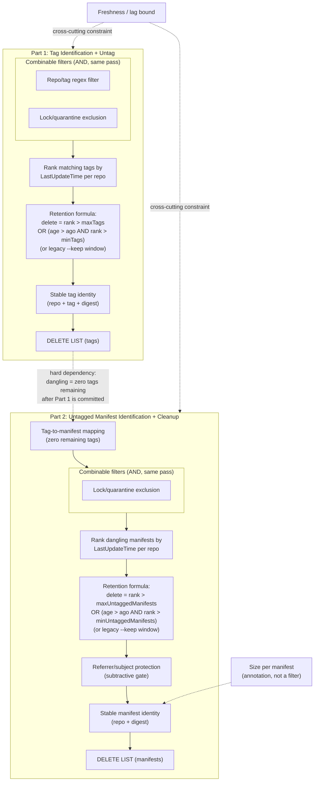

# Azure Resource Graph (ARG) Integration for Purge: Requirements Spec

For usage, query examples, and custom policy guidance, start with the
[ARG Mode Guide](arg-mode.md). This document retains the design investigation
and historical experiments.

## Summary

Draft / discussion notes. This doc assumes that ARG is enabled for an azure container registry and that said ARG is capable of providing manifest and tag level information. The goal here is to document what types of queries we currently support today in the acr-purge command by building a registry store locally. If we want to provide ARG support we need to provide similar functionality though we can build a separate more constrained purger if necessary. There are no concrete queries here, just scenarios and expectations supported by the existing purger.

**Current implementation:** `acr purge --arg` is a dry-run-only hybrid.
Registry metadata supplies current state; ARG supplies only manifest bodies.
The standalone pure-ARG prototype and its candidate selector have been removed.
Their commands, selection rules, and zero-registry-read integration below are
historical records, not supported entry points. See
[Approved Hybrid](#approved-hybrid-registry-state-and-arg-manifest-bodies).

## Background

Today, `acr purge` derives delete decisions by enumerating a registry's
catalog, tags, and manifests directly via data-plane calls
(see `cmd/acr/purge.go`). Purge runs in two phases:

1. **Tag identification + untag** (`purgeTags`)
2. **Untagged manifest identification + cleanup** (`purgeDanglingManifests`)

The original goal of pure ARG integration was to let ARG compute the delete set(s), with
purge (or a thin executor) only issuing the data-plane delete calls against
that set.

This spec also folds in the retention-policy proposal from
[Azure/acr-cli#670](https://github.com/Azure/acr-cli/issues/670), which adds
`--min-tags`/`--max-tags` and `--min-untagged-manifests`/`--max-untagged-manifests`.
That proposal replaces simple "keep-N" with a per-repo rank plus a combined
OR/AND formula which will be merged soon and has been asked for by openai.

```text
delete := rank > maxCount
          OR
          (olderThanAgo AND rank > minCount)
```

`--min-*` requires `--ago` (it only guards age-based deletion); `--max-*` is a
hard ceiling independent of age; `--keep` remains unchanged but is mutually
exclusive with the new min/max options for the same resource. This means any
ARG query plan must compute **rank** before applying age, not after.

## Requirements Graph



As visible from the diagram above we have a hard dependency between the two flows. I am not sure ARG can support such real time updates so we might still need a small clientside wrapper. Also note that we avoid executing deletions based on locks, if ARG does not have this information its not a must. We can issue deletes which will get rejected instead of avoiding the requests and do not need to support locked image cleanup.

## Part 1: Tag Identification + Untag

| # | Requirement | Order/Dependency | Open Question |
|---|---|---|---|
| 1a | Repo/tag regex filter | Defines the "matching" set, applied first, combinable with 4a | Server-side pattern match, or pulled then filtered client-side? |
| 2a | Age threshold (tag last-updated) | Combined via formula with 3a/5a, not pre-filtered | Last update time (push) today (Last pull might be nice later) |
| 3a | Rank matching tags by recency, per repo | Must run before the retention formula; needed for `--keep`, `--min-tags`, and `--max-tags` alike | Native ranking/windowing, or client-side post-processing? |
| 4a | Lock/quarantine exclusion | Same pass as 1a; locked items also need to be reportable when they block a `--max-tags` ceiling | Single boolean, or distinguish quarantine vs. explicit lock? If not present, this can be skipped |
| 5a | Retention formula (min/max/keep) | `delete = rank > maxTags OR (age > ago AND rank > minTags)`; legacy `--keep` is a separate, mutually exclusive mode | Can the index evaluate this formula natively, or must it be computed client-side after fetching rank+age? |
| 6a | Freshness/lag bound | Cross-cutting on whole pipeline | Indexing SLA, per-registry or global? |
| 7a | Stable tag identity (repo + tag + digest) | Final output shape | Sufficient to call untag directly, or needs re-resolution? |
| 8a | Delete-reason attribution (age vs. max vs. both) | Annotation on final output, required for dry-run parity with #670 | Can the query surface *why* each row was selected, or only the final boolean? |

## Part 2: Untagged Manifest Identification + Cleanup

| # | Requirement | Order/Dependency | Open Question |
|---|---|---|---|
| 1b | Tag-to-manifest mapping (zero remaining tags) | Must run after Part 1's deletions are reflected | Does the index reflect tag deletions in near-real-time, or only on next sync? |
| 2b | Lock/quarantine exclusion | Defines the "matching" dangling set, same pass as 1b | Does lock state apply at manifest level independent of tag locks? |
| 3b | Age threshold (manifest last-updated) | Combined via formula with 4b/5b, not pre-filtered | Does manifest "last-updated" change on retag, or only on push? |
| 4b | Rank dangling manifests by recency, per repo | Must run before the retention formula; needed for `--keep`, `--min-untagged-manifests`, and `--max-untagged-manifests` alike | Same ranking capability as 3a, but scoped to manifests |
| 5b | Retention formula (min/max/keep) | `delete = rank > maxUntaggedManifests OR (age > ago AND rank > minUntaggedManifests)`; evaluated after tag deletion per #670 | Same as 5a, scoped to manifests |
| 6b | Referrer/subject protection | Subtractive gate before finalizing output | Does the index expose referrer edges (signatures/SBOMs), and in which direction? |
| 7b | Size per manifest | Additive annotation, not a filter | Tracked per manifest, per layer, or both? |
| 8b | Freshness/lag bound | Cross-cutting on whole pipeline | Same as 6a |
| 9b | Stable manifest identity (repo + digest) | Final output shape | Sufficient to call manifest delete directly? |
| 10b | Delete-reason attribution (age vs. max vs. both) | Annotation on final output, required for dry-run parity with #670 | Same as 8a, scoped to manifests |

## Validation Rules Carried Over from #670

- `--keep` behavior is unchanged and mutually exclusive with `--min-*`/`--max-*`
  for the same resource (tags vs. dangling manifests are independent).
- `--min-tags`/`--min-untagged-manifests` require `--ago`; they only guard
  age-based deletion and cannot select items on their own.
- `--max-tags`/`--max-untagged-manifests` work with or without `--ago`.
- When both are supplied, `min <= max`.
- Limits apply per repository and effective filter; tag and dangling-manifest
  limits are independent of each other.
- Ranking must be deterministic and stable across paginated results, with a
  defined tie-break for equal `LastUpdateTime` values.
- Dry-run output must distinguish whether a deletion is due to age, a max-count
  ceiling, or both, so any ARG-backed plan needs to preserve that attribution,
  not just emit a final delete/keep boolean.

## Cross-Phase Dependency

Part 2's entry point (tag-to-manifest mapping) has a hard dependency on
Part 1's delete list being executed or at least finalized: "dangling" is only
meaningful relative to the post-Part-1 tag state, not the pre-purge snapshot.
This is the only edge connecting the two phases.

## Historical Read-Only Prototype: Basic Untagged Cleanup

`scripts/experimental/arg-purge` was a standalone Go prototype for Part 2.
It and its candidate selector were removed because historical Tag entities
cannot establish current tag assignments. Native discovery and manifest-body
validation remain in `internal/arg` for the hybrid command.
The historical standalone prototype never untagged,
deleted, pushed, or changed roles. It sent HTTP requests directly from Go
with Azure Identity ARM credentials, independently selectable regional ARM
endpoint and API version, and no Azure CLI dependency. Managed-identity
authentication may contact its hosting environment's identity endpoint;
no registry data-plane calls are made.

The basic predicate is **older than X days AND untagged AND not reachable from
a tagged manifest**, not an OR between untagged and unreferenced. An untagged
platform manifest underneath a tagged multi-architecture index must survive.
The existing purger uses manifest `lastUpdateTime`; ARG's observed field is
`pushedAt`. The prototype explicitly reports that different age basis.

### Live Findings (October 14, 2026)

For `esreyacrcli.azurecr.io`, subscription
`e41344e4-fa06-4f72-b974-00bc6d058dc4`:

- Initial subscription-wide probes through Southeast Asia, West US, and the
  global endpoint succeeded but returned zero artifact rows. Later, the same
  Southeast Asia endpoint returned **479 rows: 429 manifests and 50 tags**.
  No roles, registry settings, or content were changed by this prototype.
- The Southeast Asia endpoint returned the registry from the `Resources`
  table. Its ARM location is `westus`; the query endpoint need not match that
  location.
- The first captured ARG inventory covered only `test-1` through `test-5`,
  while the data-plane catalog contained **34 repositories**. Its `pushedAt`
  values were all around 21:50 UTC on October 14. A separate data-plane sample
  from `mostuntagged-1` contained untagged manifests last updated February 5.
  Full historical coverage is therefore not demonstrated.
- Using the consistent capture, `--ago-days 0` selected **101 candidates** and
  protected **328 manifests**. Candidate counts by repository were 17, 17, 31,
  25, and 11 for `test-1` through `test-5`. `--ago-days 7` selected zero.
- All 101 candidates existed and were untagged in subsequent data-plane
  metadata reads. For 81, ARG `pushedAt` and data-plane `lastUpdateTime` matched
  to the second; 20 differed, including ARG `21:50:37Z` versus data-plane
  `21:50:41.6259014Z`. These are not proven interchangeable timestamps.
- A tagged index in `test-4`, digest
  `sha256:24fe3f96130d0a339632f67bc62fc0794ec57d54b42ac681af53efa360600744`,
  had exactly the same four child digests in ARG and its data-plane manifest
  body. This checks one real reference edge set, not the entire graph.
- Subsequent data-plane counts for those five repositories totaled **2,545
  manifests**, versus 429 in the initial ARG capture. All 429 captured digests
  still existed. These were non-atomic observations during changing inventory,
  not a measurement of steady-state ingestion lag.
- Later live ARG queries showed duplicate repository/tag names with different
  digest targets, for example `test-1:tag3`. The prototype rejects this
  ambiguity rather than choosing a target and emitting a misleading plan.

**Conclusion:** the observed schema supports a read-only ARG-backed candidate
prototype. Registry-wide completeness, freshness, timestamp equivalence,
and full data-plane reference parity are **not established**. Do not delete
based on this experiment. The supplied onboarding and cluster-access document
titles were not links or local files; their contents were unavailable.

### Querying the API

The removed prototype used this invocation (defaults: Southeast Asia,
API `2024-04-01`). This is retained for historical context, not current usage:

```bash
go run ./scripts/experimental/arg-purge \
  --registry esreyacrcli \
  --ago-days 7
```

Its `--discover` flag returned raw records instead of candidates, and
`--snapshot` replayed captures. These modes were removed with the prototype.
For current API queries and commands, use the [ARG Mode Guide](arg-mode.md).

The Go command POSTs to
`https://southeastasia.management.azure.com/providers/Microsoft.ResourceGraph/resources?api-version=2024-04-01`
with the token scope `https://management.azure.com/.default`. First, when
no explicit registry ID is supplied, it resolves the name through ARG:

```kusto
Resources
| where type =~ 'microsoft.containerregistry/registries'
| where name =~ 'esreyacrcli'
| project id, name
| order by id asc
```

Without a subscription override this queries the ARM identity's accessible
subscription scope. Discovery requires exactly one complete match; zero,
multiple, truncated, or malformed matches are errors. The resolved
subscription scopes the subsequent artifact query:

```kusto
ContainerRegistryResources
| where type =~ 'microsoft.containerregistry/registries/artifacts'
| where id startswith '/subscriptions/e41344e4-fa06-4f72-b974-00bc6d058dc4/resourceGroups/esrey/providers/Microsoft.ContainerRegistry/registries/esreyacrcli/'
| order by id asc
```

It requests `objectArray` results, follows `$skipToken`, and rejects truncation
without continuation, repeated tokens, or changing record counts. An empty
inventory is an explicit error, not an empty candidate list. Ordering and
count checks do not make multiple ARG pages a transactionally consistent
snapshot. Native artifact IDs observed here are hierarchical beneath the
registry, so scoping does not depend on the opaque `registryArtifact.registryId`.
Use `--endpoint-region global` for a global comparison with the same API
version. The supplied example's `%22` at the end of the URL is a pasted quote,
not part of the API version.

### Native Mapping and Selection

The observed native mapping is:

| Native Field | Meaning |
|---|---|
| `kind` | `Manifest` or `Tag` |
| `properties.registryArtifact.repository` | Repository name |
| `properties.registryArtifact.digest` | Manifest digest / tag target |
| `properties.registryArtifact.tag` | Tag name on a `Tag` row |
| `properties.registryArtifact.pushedAt` | Observed push timestamp; not validated as data-plane `lastUpdateTime` |
| `properties.registryArtifact.manifest` | Indexed manifest body |
| `...manifest.manifests[].digest` | Child manifest edges on indexes/lists |
| `...manifest.subject.digest` | Subject edge, when present in an OCI body |

There is no tag array on the manifest row: the command combines **all** tag
rows with manifest rows using repository + digest. The top-level resource
`tags` property is not the image's tags. Children come from manifest
descriptors, not config/layer digests. Recognized image manifests without a
subject have no subject edge according to their manifest schema; unknown
media types and incomplete manifest bodies are rejected. Live subjects were
not present in this capture, so subject handling is covered by fixtures only.

Fetch **all** manifests and tags, not just old or untagged rows.
The selector builds a repository-scoped digest graph, traverses all descendants
of retained roots, then selects old untagged manifests outside that graph.
It protects shared and nested children, handles cycles, and keeps repositories
separate even when digests coincide. Roots include tagged manifests and
manifests at or newer than the cutoff. Conservatively, referrers and their
subjects also remain protected, along with their descendants. This is more
constrained than the existing purger's server-managed subject cleanup and is
not intended as behavioral parity.

Missing fields, invalid timestamps, duplicate manifest identities, ambiguous
tag names, cross-registry rows, and absent referenced manifests are errors.
Validation cannot detect wholly absent/disconnected artifacts or missing tag
rows due to indexing lag. Locks are not evaluated, so candidates are not
necessarily deletable.
Output contains the cutoff, inventory/protection/candidate counts, and
repository + digest + `ageTimestamp` + reason for each candidate. `ageBasis`
explicitly distinguishes ARG `pushedAt` from a synthetic timestamp.

Offline algorithm fixtures may also use `--snapshot` with a normalized JSON
array. Required fields are `id`, `repository`, `digest`, `tags` (array),
`ageTimestamp` (RFC3339 timestamp), `children` (digest array), and `subject`
(digest string or explicit null). This normalized format is not the native
ARG schema.

### Feasibility and Remaining Gates

The native fields support a KQL age predicate:

```kusto
| where kind == 'Manifest'
| where todatetime(properties.registryArtifact.pushedAt) < ago(7d)
```

A live server-side age-count query succeeded and returned zero old manifests.
Live queries also successfully expanded child descriptors with `mv-expand`
and joined those edges to `Tag` rows by repository + parent digest. Direct
relationship construction in ARG is therefore demonstrated. Unmatched-row
filtering can be built using joins; a single-level exclusion would not
establish transitive reachability for nested indexes. This prototype
intentionally computes reachability client-side after fetching the inventory;
it does not claim an ARG-only recursive query has been demonstrated.

Before enabling deletion through ARG mode:

1. Compare the full candidate set and reference graph with data-plane manifest
   bodies. Metadata/tag comparisons alone do not validate child reachability.
2. Establish ingestion freshness and coverage, including pre-existing content,
   retags, untag operations, nested indexes, OCI referrers, and the meaning and
   precision of `pushedAt`.
3. Establish a freshness/completeness contract sufficient for ARG-only candidate
   discovery. Routine registry reads must not become a hidden dependency or
   fallback; independent data-plane comparisons here are investigation checks,
   not part of the candidate builder. An eventually consistent ARG snapshot
   alone must not authorize deletion.
4. Add explicit lock handling and deletion ordering, then consider retention
   ranking and the separate post-untag phase described above.

Focused offline checks:

```bash
go test ./internal/arg ./cmd/acr ./scripts/experimental/arg-purge
```

### Historical Pure-ARG Purge Command Integration (Superseded)

This section records the earlier integration, now replaced by the approved
hybrid below. Its zero-registry-read constraint and unsupported-flag list no
longer apply to `acr purge --arg`. The initial subset was **read-only**:

```sh
acr purge -r esreyacrcli \
  --arg \
  --untagged-only --ago 7d --dry-run
```

The ARG branch runs before registry authentication or client creation. Both
entry points use the same parser, pagination, graph protection, and candidate
selection. Native ARM HTTP requests and token acquisition honor the command's
cancellation context. The Azure SDK pipeline handles bearer-token caching
and transient HTTP retries; HTTP/authentication failures remain errors.
Omitting `--arg` preserves the original purge behavior.

Supported flags are `--registry`, `--arg`, optional `--arg-registry-id`,
`--arg-subscription`, `--arg-region`, `--arg-api-version`,
`--untagged-only`, `--ago`, `--dry-run`,
and optional `--filter` / `--filter-timeout-seconds`. Repository filters use
the existing regex parser and are applied to final candidates without changing
the retained-parent graph. The tag expression is ignored, as in the existing
untagged-only mode. An explicit age threshold is required in ARG mode.

Retention (`--keep`), tag deletion, lock overrides, concurrency, repository
page size, ABAC verbosity, and Docker/registry authentication flags are
rejected. ARG-specific options without `--arg` are also errors. No ACR
data-plane reads, registry credential resolution, or deletions occur on this
path. It uses `DefaultAzureCredential`: environment service-principal,
workload, managed-identity, and optional development credentials. Azure CLI
is optional and used only as a local token source, never to send requests.
`AZURE_TOKEN_CREDENTIALS=prod` selects hosted credential types; a specific
credential name can select an individual source. Registry scope resolution
is ARG-only, and currently supports public-cloud names/login servers.
The full ARM ID is an optional override and must match the requested name.

The command reports advisory ARG candidates rather than implying deletion
parity with ordinary purge. A complete KQL-only candidate selector and safe
deletion execution are not part of this integration.

The integrated live dry run reached ARG and rejected conflicting
`test-5:tag0` targets before printing candidates. It did not fall back to
registry authentication or data-plane enumeration.

After replacing `az rest` with the native client, the name-only invocation
resolved `esreyacrcli` to its expected ARM ID and reached artifact pagination.
The live inventory's `totalRecords` changed from 21,530 to 21,649 between
pages, so the command rejected that inconsistent capture. This check used
Azure CLI only as the optional local token source via
`AZURE_TOKEN_CREDENTIALS=AzureCLICredential`. Native HTTP fixtures also pass
with no executables on `PATH`; hosted-identity authentication is provided by
the SDK but was not exercised against a live managed/workload identity here.

### Reproducible Dry-Run Comparison (2026-10-14 UTC)

Seven paired scenarios were run against `esreyacrcli` using the same built
binary. Both commands used `--untagged-only --dry-run`, with the age and
repository filter below. The tag expression `ignored` intentionally exercises
the documented repository-only filtering behavior.

| Scenario | `--ago` | `--filter` (omit when empty) | Original Candidates | Original Seconds | ARG Seconds |
| --- | --- | --- | ---: | ---: | ---: |
| `all-7d` | `7d` | | 112 | 356.38 (retry) | 50.42 |
| `all-0d` | `0d` | | Incomplete | 240.00 (timeout) | 39.90 |
| `all-30d` | `30d` | | Incomplete | 240.00 (timeout) | 46.96 |
| `test1-0d` | `0d` | `^test-1$:ignored` | 964 | 21.17 | 42.26 |
| `test4-0d` | `0d` | `^test-4$:ignored` | 879 | 20.70 | 38.33 |
| `test5-7d` | `7d` | `^test-5$:ignored` | 0 | 20.08 | 38.82 |
| `tests1to5-0d` | `0d` | `^test-[1-5]$:ignored` | 4,481 | 95.79 | 44.55 |

**Every ARG run exited with an error before producing candidates**, not an
empty candidate set. All reported conflicting targets for `test-5:tag3`:

```text
sha256:dbc1f500b3cda4a99239aa42bfffcb0c6ab0acdbf52076a652e989bf572590c1
sha256:e39c68cb6d69ee924bb977f0da79331461b3177031a4b4a5c29add4da25622de
```

The default per-command bound was 240 seconds. The initial original `all-7d`
run also timed out; one retry with a 420-second bound completed with 112
candidates in 356.38 seconds. Timed-out outputs are partial, not valid complete
candidate sets. These are single-run diagnostic timings, including
authentication, not a speedup benchmark. Some diagnostic requests and the
extended retry overlapped other runs.

The inventory was stable during this comparison: two independent complete ARG
captures contained exactly the same 23,902 rows after sorting by resource ID
and canonicalizing JSON. They contained 22,451 manifests and 1,451 tag rows.
Nevertheless, 101 repository/tag identities had multiple target digests:
20 each in `test-1` through `test-5`, plus one in `test-7`. This is no longer
just a changing-pagination-count failure. Current-tag semantics or ingestion
cleanup must be established; selecting the newest `pushedAt` target is not
assumed safe. Since ARG filters are applied after registry-wide normalization,
repository-scoped commands also reject the conflicting inventory.

An independent comparison of original candidates with the captured ARG
manifest identities also found incomplete coverage:

| Original Scenario | Candidates | Present in ARG | Missing From ARG |
| --- | ---: | ---: | ---: |
| `all-7d` (completed retry) | 112 | 0 | 112 |
| `test1-0d` | 964 | 865 | 99 |
| `test4-0d` | 879 | 780 | 99 |
| `tests1to5-0d` | 4,481 | 4,012 | 469 |

These are observations across separate reads, not proof of a permanent
backfill limitation. However, stable pagination alone demonstrably does not
establish complete registry coverage. The original `test-1` and `test-4`
candidate digest sets exactly matched their respective subsets of the later
five-repository run. Candidate parity and a successful ARG performance
comparison remain blocked by inventory ambiguity and coverage.

#### Reproduction

Build from the working tree and obtain temporary registry credentials for
ordinary purge. The ARG command uses the same Azure CLI identity as its
optional development credential source; it still makes native HTTP requests.
This setup requires `az`, `jq`, and `/usr/bin/time`, not Docker:

```bash
umask 077
workdir="$(mktemp -d)"
trap 'rm -f "$workdir/config.json"' EXIT
go build -o "$workdir/acr" ./cmd/acr
az acr login --name esreyacrcli --expose-token \
  --query accessToken --output tsv |
  jq -R '{auths: {"esreyacrcli.azurecr.io": {identitytoken: .}}}' \
  > "$workdir/config.json"
```

For each table row, set `ago` and `filter` to its exact values; use
`filter=''` for the unfiltered scenarios. Run the pair and preserve both
exit statuses, complete output, and timings:

```bash
ago=0d
filter='^test-1$:ignored'
scenario=test1-0d
flags=(purge -r esreyacrcli --untagged-only --ago "$ago" --dry-run)
if [[ -n "$filter" ]]; then flags+=(--filter "$filter"); fi

/usr/bin/time -f 'elapsed_seconds=%e exit_status=%x' \
  -o "$workdir/$scenario.original.time" \
  timeout 240 "$workdir/acr" "${flags[@]}" --config "$workdir/config.json" \
  > "$workdir/$scenario.original.log" 2>&1
original_status=$?

AZURE_TOKEN_CREDENTIALS=AzureCLICredential \
  /usr/bin/time -f 'elapsed_seconds=%e exit_status=%x' \
  -o "$workdir/$scenario.arg.time" \
  timeout 240 "$workdir/acr" "${flags[@]}" --arg \
  > "$workdir/$scenario.arg.log" 2>&1
arg_status=$?
printf 'original_status=%s arg_status=%s\n' "$original_status" "$arg_status"
```

For the completed registry-wide `7d` retry, change the original command's
timeout to `420`. Only compare digest sets after both commands exit
successfully: original candidates are lines prefixed `Would delete: ` and
ARG candidates are lines prefixed `ARG candidate: `. Compare the remaining
`repository@digest` identities after removing the common login-server prefix
and sorting uniquely, rather than comparing output order or counts alone.
The commands use relative age thresholds and separate reads, not an atomic
shared snapshot; ordinary purge also computes a cutoff per repository.
Future runs can legitimately differ as inventory, tag state, or ages change.
No deletion or registry fallback is enabled by this procedure.

### Registry Reset and ARG Deletion Validation (2026-10-15 UTC)

At the user's explicit request, deleted all 69 repositories from
`esreyacrcli.azurecr.io`, including tagged images. The registry ARM resource
was not deleted or reconfigured. After bounded retries for partial deletions,
`az acr repository list --name esreyacrcli` returned `[]` at 00:20:18 UTC.
A final catalog check after monitoring still returned `[]`.

| ARG Records | Before Cleanup | After Cleanup |
| --- | ---: | ---: |
| Manifests | 22,451 | 2 |
| Tags | 1,451 | 1,451 |
| All Artifacts | 23,902 | 1,453 |

Twenty regional ARG checks from 00:20:24 through 00:30:22 UTC all returned
the same 1,453 residual records. A global-endpoint probe also returned the
same counts. Both used API version `2024-04-01`; the regional endpoint was
`southeastasia.management.azure.com`.

The two residual manifest rows were:

```text
test-30@sha256:ebf1b71d1058018b0424976b9211c20610ca756efd3ecd8d77146dd3124a49eb
test-3@sha256:7236106673d5dc126eaf938474bd6ef736ae76a1cc361c92305db7fb6d03961f
```

Independent registry metadata lookups for both digests returned
`manifest unknown`. Thus the registry cleanup completed, but **an empty ARG
baseline was not established** within the approximately ten-minute monitoring
window. The remaining records do not represent content found by those registry
lookups. Whether their presence is unexpected staleness or intended retention
of deletion records requires verification of the table's deletion semantics.

The registry-scoped ARG check was:

```kusto
ContainerRegistryResources
| where type =~ 'microsoft.containerregistry/registries/artifacts'
| where id startswith '/subscriptions/e41344e4-fa06-4f72-b974-00bc6d058dc4/resourceGroups/esrey/providers/Microsoft.ContainerRegistry/registries/esreyacrcli/'
| summarize artifacts=count(),
            manifests=countif(kind =~ 'Manifest'),
            tags=countif(kind =~ 'Tag')
```

The success criterion used was zero artifacts, followed by a raw query returning
`data: []` and a still-empty registry catalog. That criterion was not met;
the bounded monitor stopped rather than polling indefinitely or treating a
partial reduction as successful convergence. This all-row criterion must be
revisited if the schema intentionally includes deletion records. Request bodies, responses,
timestamps, deletion inventory, and residual-manifest checks are retained in
the session artifacts under the `registry-cleanup-*` prefix.

At the user's request, monitoring continued. Thirty additional two-minute
checks from 00:53:31 through 01:52:14 UTC all returned the same 1,453 records.
That is approximately 92 minutes after the registry catalog became empty,
with no further reduction. A fresh catalog check still returned `[]`, and
the global ARG endpoint still returned two manifests and 1,451 tags.
Retention and soft-delete policies were also confirmed disabled; the
soft-deleted-manifest listing operation was disallowed under that policy.
The extended observations establish persistent nonzero all-row counts, not
whether deletion records are expected to remain in this table.

Further checks through 03:54:42 UTC remained at exactly two manifests and
1,451 tags, over three and a half hours after the catalog became empty.
No continued progress toward an empty ARG baseline was observed.

After the user pointed out a `deleted` field, deletion-state interpretation
was re-examined. The count queries above have no deletion predicate. Sampled
full rows from the public ARG API did not expose a top-level `deleted` field,
and `summarize records=count() by kind, deleted` failed with
`Failed to resolve scalar expression named 'deleted'` at 18:12 UTC.
The table/view and exact field path seen by the user remain unidentified.
Do not assume that the backing Kusto schema and the public ARG API expose
identical fields, or conclude that every returned row is intended to represent
current inventory without establishing that contract.

At 21:09 UTC, the user reported confirmation that Tag entities are retained
as tag history. Their continued presence and multiple historical targets
therefore must not be interpreted as evidence of failed tag deletion
propagation. A manifest tag list assembled from these entities is not
verified current tag state. Zero Tag rows is not an appropriate empty-registry
criterion.

The user considers the two residual Manifest rows a nonblocking data-quality
discrepancy for read-only evaluation. These observations no longer justify
blocking evaluation until all historical rows disappear. They do not establish
exact current-tag or purge-candidate parity.

The current prototype still rejects repeated repository/tag identities and
requires every history target to exist in the manifest inventory. Those
assumptions do not establish current tag state. The proposed compromise of
protecting every historical target was rejected; it is not a supported
evaluation mode.

### Current-State Entities Only

Only current-state entities may enter ARG purge candidate construction.
Historical Tag entities must not be used as current assignments, protection
roots, or an approximate replacement for current tag state.

Purge first untags selected images, then cleans up eligible untagged manifests.
Protecting historical tag targets would prevent the second phase from deleting
the very manifests made untagged by the first phase. That breaks purge
semantics rather than merely producing a more conservative result.

For a pure ARG selector, ARG must provide a verified current-state view of tag
assignments and manifest relationships, excluding historical entities. The
working graph must also reflect tags removed by the current purge operation.
Do not choose the newest history entry or protect all history targets.
The subsequently approved hybrid makes registry metadata reads an explicit
part of its architecture, not a hidden candidate-construction fallback.

Until that current-state contract is available, the native ARG prototype does
not meet the required candidate-selection semantics. Read-only transport,
schema, and performance investigation can continue, but historical-entity
support is out of scope. The hybrid below addresses current-state selection
through registry metadata without changing that prohibition.

### Fresh Sample Repository Check (2026-10-15 UTC)

After the user pushed new images to `sample-1` through `sample-5`, a delayed
check captured full paginated ARG discovery starting at 21:47:03 UTC.
Independent registry manifest-list metadata reads were then compared by
repository and digest, not just by count.

| Repository | ARG Manifests | Registry Manifests | Currently Tagged | Currently Untagged |
| --- | ---: | ---: | ---: | ---: |
| `sample-1` | 113 | 113 | 10 | 103 |
| `sample-2` | 111 | 111 | 10 | 101 |
| `sample-3` | 113 | 113 | 10 | 103 |
| `sample-4` | 91 | 91 | 10 | 81 |
| `sample-5` | 91 | 91 | 10 | 81 |
| Total | 519 | 519 | 50 | 469 |

All 519 manifest identities matched exactly: no sample manifest was missing
from ARG or present only in ARG. The current-tag counts above come exclusively
from the independent registry metadata responses, not from historical Tag
entities. Untagged counts are not purge-candidate counts; age and retained
parent/reference protection still apply.

None of these 519 ARG Manifest rows contained non-null tags at the top level,
under `properties`, or under `properties.registryArtifact`. Their artifact
fields were `config`, `digest`, `manifest`, `pushedAt`, `registryId`, and
`repository`; no current tag list or tag-count field was present. The fresh
dataset therefore demonstrates complete observed manifest-identity coverage,
but does not resolve the current-tag metadata requirement.

The discovery also contained two older residual Manifest rows, which were
excluded from this sample comparison. These registry reads preceded the hybrid
implementation and were independent investigation checks, not a fallback in
the original selector. Raw discovery, metadata responses, timestamp, and exact digest
comparisons are retained in session artifacts under `arg-post-push-*`.

### Approved Hybrid: Registry State and ARG Manifest Bodies

The approved experiment targets manifest-body GETs rather than replacing
current-state metadata listings. It reuses the existing purge algorithm:

1. Authenticate to the registry normally and select repositories using the
   existing catalog/filter logic.
2. Resolve the registry ARM ID natively and load only ARG `Manifest` entities
   for those selected repositories. Historical `Tag` entities are never queried
   or consumed by this path.
3. List current registry tags/manifests as before. Use registry `lastUpdateTime`,
   current tags, lock attributes, filtering, and `--keep` semantics unchanged.
   In tag-plus-manifest mode, preserve the existing dry-run accounting for
   tags planned for removal before evaluating untagged manifests.
4. Override only the client's `GetManifest`: return the indexed body by
   repository/digest when valid, otherwise perform a counted registry GET.
   Existing nested-index traversal and subject/referrer handling run unchanged.
5. Print ordinary dry-run candidates and cache/fallback counters. No tag
   deletion, manifest deletion, or unlocking is enabled in hybrid mode.

Example commands, with ordinary registry authentication already configured:

```sh
acr purge -r esreyacrcli --arg --dry-run \
  --untagged-only --ago 0d --filter '^sample-[1-5]$:ignored'

acr purge -r esreyacrcli --arg --dry-run \
  --untagged --ago 0d --filter '^sample-[1-5]$:.*'
```

`--ago` is optional in untagged-only mode, as in ordinary purge. Existing
registry credentials/configuration, retention, lock, concurrency, repository
page-size, and verbosity options remain usable. Registry and ARM credentials
are independent; `DefaultAzureCredential` is still the ARM token source.
The earlier zero-registry-read constraint is explicitly superseded for this
hybrid, not silently relaxed in the original pure selector.

An ARG row alone cannot make an image a candidate: candidates still originate
from the registry listing. Extra indexed manifests do not become current
inventory or protection roots. Missing indexed children can be fetched from
the registry through the same wrapper when existing traversal requests them.
Unsupported/malformed bodies and ambiguous duplicate identities are rejected
from the body cache, generate warnings, and use counted fallbacks if requested.
An empty successful ARG inventory is a valid empty cache, not an assertion that
the registry is empty. ARG authentication, HTTP, malformed inventory, and
pagination errors remain fatal instead of silently falling back wholesale.

The summary distinguishes cached/rejected identities, logical manifest-query
pages, body-cache hits, and registry GET fallbacks split by missing/invalid
body. Page counts exclude registry-ID lookup, token acquisition, and HTTP
retries. Cache hits count body requests, not necessarily unique digests.

For direct request-volume measurement, temporarily enable
`--debug-request-counts` in both modes. Per-run counters include registry
authentication (including the initial token exchange and ABAC refreshes),
catalog requests, tag lists, manifest metadata lists, manifest-body GETs,
other registry requests, and ARG query attempts (registry lookup and inventory
pages). Registry counts sit below SDK retry handling; ARG counts run after ARM
bearer-token acquisition on each retry. Failed send attempts are counted, too.
Totals exclude ARM credential acquisition, external CLI/credential helpers,
and HTTP-client-internal redirects. They measure SDK HTTP attempts, not
physical connections or a complete wire-level trace. No request contents or
identifiers are recorded. Summaries print on failure as well as success.

Paired zero-day dry runs on October 19, 2026 used `--concurrency 4`,
`--filter '^sample-[1-5]$:.*'`, identical registry configuration, and
`--debug-request-counts`. Only the hybrid added `--arg`:

| Mode | Total Attempts | Registry Auth | Catalog | Tag Lists | Manifest Metadata | Manifest GETs | ARG Queries |
| --- | ---: | ---: | ---: | ---: | ---: | ---: | ---: |
| Original untagged-only | 306 | 1 | 2 | 0 | 13 | 290 | 0 |
| Hybrid untagged-only | 18 | 1 | 2 | 0 | 13 | 0 | 2 |
| Original tag-then-manifest | 320 | 1 | 2 | 5 | 13 | 299 | 0 |
| Hybrid tag-then-manifest | 23 | 1 | 2 | 5 | 13 | 0 | 2 |

Every other-registry count was zero. Both exact candidate sets matched:
165 manifests for untagged-only; 50 tags plus 519 manifests for tag-then-manifest.
Each hybrid cache loaded 519 bodies in one manifest-query page, with zero
fallback GETs; its second ARG query resolved the registry ARM ID. Total
attempt reductions were 94.1% and 92.8%, respectively. Baseline body GETs
and hybrid cache hits need not match exactly because concurrent graph
traversal can perform repeated body inspections.

These measurements establish request savings on the existing sample, not
latency improvement or larger-scale performance. Logs, sorted candidate
sets, timings, and the comparison harness are retained as session artifacts
under `request-count-comparison-20261019/` and `compare-request-counts.sh`.
All invocations were dry runs with 180-second deadlines; temporary registry
credentials were removed afterward and no registry content was changed.

The October 15 fresh sample capture contains 129 indexes, 444 parent/child edges, and
99 nested indexes; every referenced child was present. It contains **zero
subject-bearing manifests**, so live ARG referrer fidelity is not demonstrated.
Focused fixtures cover indexed subjects and preserve existing referrer
behavior, but the command remains dry-run-only pending broader live validation.

#### Expanded Full-Registry Comparison (2026-10-19 UTC)

After additional pushes, paired dry runs covered all 40 catalog repositories,
including `another-*`, `lookonemore-*`, `sample-*`, and
`samplewithreferrers-*`. Both modes used the same binary, registry credentials,
`--ago 0d --filter '.*:.*' --concurrency 4 --debug-request-counts --dry-run`;
the hybrid added only `--arg`.

| Scenario | Original Attempts | Hybrid Attempts | Request Reduction | Original Seconds | Hybrid Seconds |
| --- | ---: | ---: | ---: | ---: | ---: |
| Untagged-only | 11,486 | 303 | 97.36% | 508.09 | 348.70 |
| Tag-then-manifest | 11,255 | 343 | 96.95% | 600.78 | 351.22 |

Exact tag/digest deletion sets matched in both pairs: 9,724 manifests in
untagged-only mode; 1,707 tags plus 20,772 manifests in tag-then-manifest mode.
Every extracted identity was unique and the counts matched command summaries.
The hybrid cached 21,684 bodies, rejected zero, and used zero fallback GETs.
Both hybrid runs made 23 ARG queries: one registry lookup and 22 manifest pages.
They replaced 11,206 and 10,935 baseline registry manifest GET attempts,
respectively. Registry metadata work remained 277 requests, plus two catalog
requests and one authentication request; tag-then-manifest added 40 tag lists.

Elapsed time decreased by 31.37% (1.46x) and 41.54% (1.71x), respectively.
Request reduction does not translate proportionally to elapsed-time reduction:
ARG body download and the remaining registry requests still cost time.
These are single paired observations, not controlled benchmark averages.
Inclusion of referrer-named repositories and candidate parity do not independently
prove that every indexed subject/body is faithful.

The first baseline attempt reached `samplewithreferrers-2` but timed out at
600 seconds without final counters. It is excluded from the table. A single
retry used 900-second per-invocation limits, ran hybrid before baseline, and
completed all four runs between 21:48:11 and approximately 22:18:20 UTC.
Initial logs remain in `request-count-expanded-20261019/`; complete results,
run timestamps, timings, and exact candidate sets are in
`request-count-expanded-retry-20261019/`. Temporary registry credentials were
removed. No registry content was changed.

#### Live Hybrid Comparison (2026-10-15 UTC)

Five paired runs started between 22:52:17 and 22:53:53 UTC. Both modes used
the same binary, registry credentials, `--dry-run`, `--concurrency 4`, and
scenario flags. The hybrid added only `--arg`; ARM authentication selected
`AzureCLICredential`. Timings include process startup, authentication, catalog
and metadata reads, ARG initialization when enabled, and candidate output.
Each invocation had a 180-second deadline; all ten completed successfully.

The comparison sorted every `Would delete:` identity and checked exact
equality, including tag names and manifest digests. It also checked that
extracted identity counts matched the command's tag/manifest summaries.

| Scenario | Tags / Manifests | Original Seconds | Hybrid Seconds | Cache Hits |
| --- | ---: | ---: | ---: | ---: |
| `sample-[1-5]`, untagged-only, `--ago 0d` | 0 / 165 | 17.23 | 11.86 | 276 |
| `sample-[1-5]`, untagged-only, `--ago 7d` | 0 / 0 | 11.73 | 12.41 | 207 |
| `sample-1`, untagged-only, `--ago 0d` | 0 / 17 | 2.86 | 4.26 | 72 |
| `sample-[1-5]`, untagged-only, `--ago 0d --keep 5` | 0 / 140 | 11.06 | 11.32 | 277 |
| `sample-[1-5]`, tag-then-manifest, `--ago 0d` | 50 / 519 | 13.26 | 12.09 | 299 |

**All five exact deletion sets matched.** Every hybrid run used one
manifest-query page, rejected zero bodies, and performed zero registry
manifest GET fallbacks. The single-repository cache held 113 bodies; the
other caches held 519. These hit counts measure requests served by the
hybrid cache, not independently instrumented baseline GET counts; traversal
and concurrency can affect repeated body requests.

The zero-day five-repository run was about 31% faster, but this is not a
general speedup claim. The single-repository case was slower, the seven-day
case was slower, and the keep-five case was approximately equal. ARG startup,
name resolution, and body download add overhead while registry catalog,
metadata, and tag work remain unchanged. These are one paired measurement per
scenario, not statistically controlled benchmarks.

Reproduction uses the same registry configuration for each pair:

```sh
# Run once without --arg and once with --arg.
acr purge -r esreyacrcli --config "$config" --dry-run --concurrency 4 \
  --untagged-only --ago 0d --filter '^sample-[1-5]$:ignored'

# Substitute --ago 7d, a ^sample-1$ repository filter, or --keep 5 for the
# corresponding untagged-only scenarios. For the tag-then-manifest case:
acr purge -r esreyacrcli --config "$config" --dry-run --concurrency 4 \
  --untagged --ago 0d --filter '^sample-[1-5]$:.*'
```

The session artifact directory `arg-hybrid-comparison-20261015/` retains all
run timestamps, exit statuses, logs, timings, and sorted candidate identities.
The temporary registry credential file was removed after the comparisons.
No registry content was changed.

Focused tests cover current tagged-parent/nested-child protection, simulated
untagging, referrer preservation, metadata forwarding, ignored extra indexed
identities, missing/invalid body fallback, cancellation, concurrent counters,
and scoped multi-page/empty ARG inventories. Validation commands:

- `go test ./internal/arg ./cmd/acr ./scripts/experimental/arg-purge`: passed.
- `go test -race ./internal/arg ./cmd/acr ./scripts/experimental/arg-purge`: passed.
- `go test ./...`: passed.
- `go vet ./internal/arg ./cmd/acr ./scripts/experimental/arg-purge`: passed.
- `git -c core.whitespace=cr-at-eol --no-pager diff --check`: passed.
